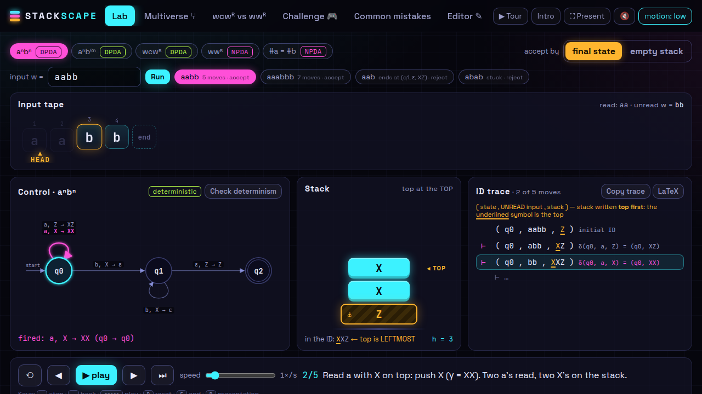
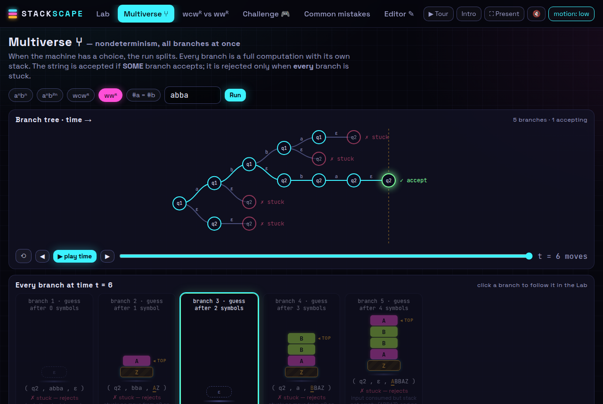

# STACKSCAPE — a Pushdown Automaton Lab

**Live:** https://3-bhd.github.io/stackscape/

An interactive simulator for pushdown automata, built for CSCE 4201 Theory of Computing (Session 20). You watch the machine run move by move: the **state**, the **unread input** and the **stack**, side by side, with every instantaneous description written in course notation.





## What's inside

| View | What it does |
| --- | --- |
| **Lab** | Input tape, state diagram and animated stack tower, all kept in step. Step forward and back, play/pause, change speed, jump to the end (keys `→` `←` `space` `R` `E`). Each step gets a one-line narration, the full ID trace with the δ used on every line (copy it as plain text or LaTeX), a verdict in course terms, a "one operation, three choices of γ" card, the acceptance-mode switch with L(M) and N(M), and a determinism inspector. |
| **Multiverse ⑂** | Nondeterminism as a branching tree you can scrub through. Every branch has its own live mini-stack, stuck branches fade out and the accepting branch lights up. Click a branch to follow it in the Lab. |
| **wcwᴿ vs wwᴿ** | DFA = NFA, but DPDA ⊊ PDA: both machines side by side, stepped together. Deleting the c turns the switch into a guess. |
| **Challenge 🎮** | (a) predict the next ID, (b) will it accept?, (c) fix the bug in six broken machines. Score and streak are kept in your browser. |
| **Common mistakes** | The three mistakes from slide 16, each with a live demo of the wrong and the right version. |
| **Editor ✎** | Write your own machine in plain text, get friendly validation and a determinism check, and share it as a link. |
| **Tour / Present** | `▶ Tour` walks through aⁿbⁿ on aabb in the slides' five steps. `P` toggles a big-font, high-contrast presentation layout. |

The first visit opens a 25-second intro (skippable, and you can replay it with **Intro**). Sound effects are off by default. Motion follows your OS reduced-motion setting and can also be turned down from the toolbar.

## Course conventions it follows

- M = (Q, Σ, Γ, δ, q₀, Z₀, F) with δ : Q × (Σ ∪ {ε}) × Γ → finite subsets of Q × Γ*.
- One move replaces the top stack symbol by γ: pop is γ = ε, leave-alone is γ = Z, push X is γ = XZ.
- An ID is (q, w, α): w is the **unread** input and α is the stack written **top first**. The tower draws the top at the top. Both are labelled every time.
- Acceptance by final state (L(M)) or by empty stack (N(M)). You choose which, and the app shows how the same run is judged both ways.
- No applicable move means that branch is stuck, which is a rejection. A string is accepted if **some** branch accepts.
- Determinism Rule 1: |δ(q,a,Z)| ≤ 1. Rule 2: if δ(q,ε,Z) ≠ ∅ then δ(q,a,Z) = ∅ for all a ∈ Σ.

## Run locally

```bash
npm install
npm run dev      # http://localhost:5173/stackscape/
npm test         # engine tests (brute-forces every preset over all strings up to length 8)
npm run build    # production build in dist/
```

Everything runs in the browser, with no backend and no API calls. A small service worker keeps the app working offline after the first visit.

## Useful links

The URL always holds the current machine, input, mode and view, so any state can be shared. Extra parameters:

- `t=3` opens the Lab at move 3
- `present=1` opens in presentation mode
- `intro=0` skips the intro

Example: `https://3-bhd.github.io/stackscape/#view=multiverse&p=wwr&w=abba&mode=empty`

## Adding a machine

**From the app.** Open **Editor ✎**, write the machine, then click **Run it in the Lab** or **Copy share link**. The format:

```
name: aⁿbⁿ
language: { aⁿbⁿ : n ≥ 1 }
Q: q0 q1 q2
Sigma: a b
Gamma: X Z
start: q0
bottom: Z
F: q2
mode: final            # or: empty
q0, a, Z -> q0, XZ     # state, read, top -> new state, γ (top first)
q1, eps, Z -> q2, Z    # eps (or ε) = the empty string
```

You can also write `δ(q0, a, Z) = (q0, XZ)`, and use `|` to list several targets on one line. Input and stack symbols are single characters.

**As a built-in preset.** Add it to `src/engine/presets.ts` (use the `mk({...})` helper and add it to `PRESETS`). Write an independent membership predicate in `src/engine/languages.ts` under the same `id`. The brute-force test in `src/engine/engine.test.ts` then checks it against every string up to length 8 automatically.

## Project layout

```
src/engine/   pure TypeScript: the PDA engine (BFS over configurations with a visited set and
              move / stack-height / configuration guards), determinism checker, parser, trace
              export, narration, presets, language predicates, tests
src/ui/       panels: tape, stack tower, state diagram, trace, playback
src/views/    Lab, Multiverse, Compare, Challenge, Mistakes, Editor, Story, Tour
```

Stack: Vite + React + TypeScript, Framer Motion and Vitest. GitHub Actions runs the tests, then the build, then deploys to GitHub Pages.
